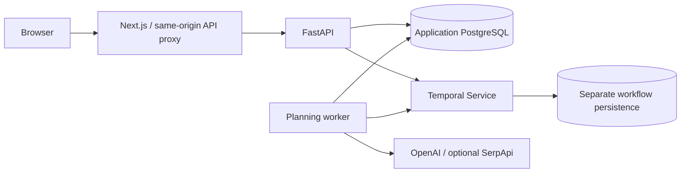

# Voyage

Voyage turns travel dates, destinations and preferences into an itinerary with
transport, stays, daily activities and estimated costs. It is a small private side
project for learning durable workflows, container delivery, Kubernetes and GitOps.

The current app uses Next.js 16 / React 19 / Material UI, FastAPI, PostgreSQL 17,
Temporal, OpenAI structured output, and optional SerpApi travel searches. Deployment
support includes GitHub Actions, GHCR images, Helm, kind, and Argo CD manifests.
Local Kubernetes deployment has been tested; public hosting and remote GitOps
synchronization have not. This is not an audited production travel service.



The browser proposes a route, saves a trip, and starts `plan-trip-{trip_id}`. Temporal
coordinates daily recommendations, schedule/budget calculations, travel searches
and narrative enrichment. The worker saves the itinerary and completed status in
one transaction. The browser polls progress and retrieves the result.

## Run locally

Prerequisites: Docker Desktop/Engine with Compose v2. PostgreSQL and Temporal data
use separate named volumes. Commands below preserve existing data.

```bash
# From the repository root. Preserve an existing .env.
test -f .env || cp .env.example .env
# For a NEW database, choose POSTGRES_PASSWORD before first startup.
# Add OPENAI_API_KEY locally if you want to use the expanded web planner.
docker compose config --quiet
docker compose up -d --build
docker compose ps
```

Open http://localhost:3000. API: http://localhost:8000/docs. Local Temporal UI:
http://localhost:8233. All host ports bind to loopback. Expanded UI planning needs
an OpenAI API key; SerpApi is optional. A no-key integration check exercises the
explicit legacy synthetic-provider path:

```bash
# Only use without provider keys if you want a strictly no-paid-call smoke test.
python3 scripts/smoke-trip.py --base-url http://127.0.0.1:3000
```

`docker compose stop` stops services without removing data. Never use
`docker compose down -v` to troubleshoot. Keep the original password when reusing
an initialized database. For native hot-reload development see the service READMEs:
[web](apps/web/README.md), [API](services/trip-service/README.md),
[worker](services/planning-worker/README.md).

## CI/CD and deployment

| Workflow | Trigger | Behavior |
| --- | --- | --- |
| CI | PRs, main pushes, reusable release checks | Ruff, pytest, ESLint, TypeScript, location/proxy/browser tests, Next production build, container builds, Compose/Helm/schema checks |
| Publish images | Successful main push CI; vX.Y.Z tags after validation | Publishes three GHCR images; full SHA tags, release tags, OCI metadata, provenance and SBOM |
| Integration smoke | Manual workflow dispatch | Builds a disposable kind environment; tests real DB/Temporal with synthetic providers; validates Argo resources |

Images are `ghcr.io/hysteven1/voyage-api`, `voyage-worker`, and `voyage-web`, tagged
`sha-<full commit>` and optionally `X.Y.Z`. Production promotion should pin registry
digests. Pull requests cannot publish. CI does not deploy or change environment
values. Argo development sync is manual; no production Application is enabled.

For a fresh local Kubernetes demo:

```bash
scripts/install-infra-tools.sh /tmp/voyage-tools
export PATH=/tmp/voyage-tools:$PATH
scripts/validate-infrastructure.sh
scripts/kind-smoke.sh
# The script leaves the dedicated cluster running for inspection.
export KUBECONFIG=/tmp/voyage-infra.kubeconfig
kubectl --context kind-voyage-infra -n voyage-dev port-forward svc/voyage-voyage-web 3000:3000
```

The automation refuses to overwrite an existing `voyage-infra` cluster.
[The Kubernetes guide](docs/kubernetes.md) has the individual build/install commands,
configuration reference, troubleshooting and explicit cleanup instructions.
[The GitOps guide](docs/gitops.md) covers Argo installation, source-image promotion,
manual synchronization and recovery after the changes are merged to GitHub.

## Data and limitations

Expanded recommendations use OpenAI; optional SerpApi searches provide actual
retrieved flight/hotel offers. Those offers can change and are mixed with labeled
estimates. Airbnb links are searches, not an inventory feed. The legacy planner
uses explicitly synthetic providers. Neither flow books travel. Daily opening
hours, availability, accessibility and capacity need independent confirmation.
See [planning behavior](docs/planning.md) for the detailed application contract.

There are no user accounts, trip ownership checks, global spending limits or refresh
recovery. Keep the app local or behind an authenticated access gateway. Development
Temporal with SQLite and the local PostgreSQL StatefulSet are not HA production
services. Production settings require external durable services and approved access.

## Engineering documentation

- [Architecture and tradeoffs](docs/architecture.md)
- [Initial repository audit](docs/repository-audit.md)
- [CI, publishing and GitHub protection](docs/ci-cd.md)
- [Kubernetes / Helm](docs/kubernetes.md)
- [Argo CD / GitOps](docs/gitops.md)
- [Environment variables](docs/environment.md)
- [Operations, observability and security](docs/operations.md)
- [Verification evidence and remaining work](docs/validation.md)
- [Portfolio demonstration](docs/portfolio.md)
