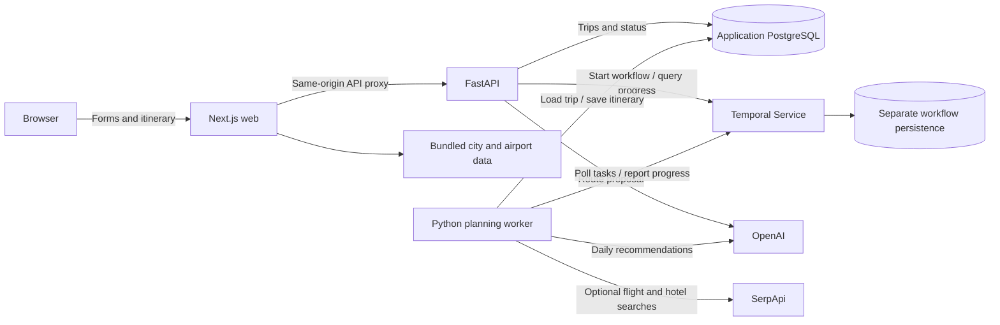
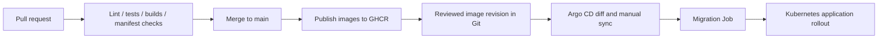

# Voyage

Voyage is an AI-powered travel planner that turns destinations, dates, budgets,
and travel preferences into a daily itinerary with transport, accommodation,
activities, and estimated costs.

The project explores the full application lifecycle: building a typed web interface,
validating AI output, coordinating background work, persisting results, packaging
services, and delivering them through CI and GitOps. It is intended for a few
private users, with an emphasis on understandable system design and reproducible
operations.

## Engineering highlights

- Developed a full-stack travel planner using Next.js, FastAPI, and PostgreSQL
  to generate personalized, budget-aware itineraries with AI recommendations
  and optional live flight and hotel searches.
- Designed Temporal workflows to coordinate background planning, parallel
  activities, automated retries, checkpoint recovery, and transactional
  itinerary persistence.
- Integrated OpenAI structured outputs with deterministic validation of trip
  dates, schedules, budgets, and traveler preferences.
- Built GitHub Actions CI and GHCR publishing workflows; implemented and locally
  validated Kubernetes deployments using Helm, migration Jobs, health probes,
  and non-root containers, with Argo CD GitOps configuration.

## What the application does

- Plans trips across multiple destinations with different travel styles and paces.
- Suggests daily activities using structured AI responses, with date, duration,
  route, and budget rules enforced in Python.
- Retrieves optional flight and hotel offers through SerpApi and retains labeled
  estimates when live offers are unavailable.
- Runs itinerary generation in the background and shows workflow progress.
- Persists trips and completed itineraries in PostgreSQL and supports retrying
  failed planning attempts.

## Technologies and their roles

| Area | Technology | Role in Voyage |
| --- | --- | --- |
| Web application | Next.js 16, React 19, TypeScript | Form state, itinerary rendering, local API routes, and a server-side proxy to the backend |
| Interface | Material UI, Emotion, Day.js | Accessible form controls, responsive layouts, date selection, and date formatting |
| Backend API | FastAPI, Pydantic | HTTP endpoints, request validation, structured trip options, and generated OpenAPI documentation |
| Persistence | PostgreSQL 17, SQLAlchemy, psycopg | Relational trip records, JSONB itinerary documents, and transactional writes |
| Schema changes | Alembic | Versioned database migrations, serialized with a PostgreSQL advisory lock |
| Background orchestration | Temporal, Python SDK | Durable workflows, activity retries, progress queries, and recovery checkpoints |
| AI planning | OpenAI API, structured output | Route suggestions, destination/day recommendations, and itinerary narrative |
| Travel search | SerpApi Google Flights / Hotels | Optional retrieved offers and booking-search links |
| Location search | GeoNames cities, airportsdata | Local city and airport autocomplete without a runtime geocoding service |
| Dependency management | uv, npm | Separate Python lockfiles and a frontend package lock for reproducible installs |
| Containers | Docker, Docker Compose | Independent application images and a complete local development environment |
| CI and registry | GitHub Actions, GHCR | Automated validation and image publication with source-SHA tags and OCI metadata |
| Deployment | Kubernetes, Helm, kind | Configurable application resources and a locally testable cluster environment |
| GitOps | Argo CD | Declarative deployment configuration, reviewed image promotion, and manual synchronization |
| Testing | pytest, Playwright, Node test runner | Planning logic, API behavior, desktop/mobile interactions, autocomplete, and proxy coverage |
| Static checks | Ruff, ESLint, TypeScript, actionlint, kubeconform | Python/frontend checks, workflow validation, and Kubernetes schema validation |

## System design

Voyage separates interactive requests from itinerary generation. FastAPI handles
validation and trip persistence; a dedicated worker performs planning activities
through Temporal. The web application communicates through its own origin, so the
browser does not need to know internal service addresses.



### From request to itinerary

1. **Propose a route.** The web form sends dates, destinations, and preferences to
   `POST /api/v1/trips/route-proposal`. The API proposes destination order and night
   allocation, then validates route constraints.
2. **Save the trip.** `POST /api/v1/trips` persists the validated trip in PostgreSQL.
3. **Start background planning.** `POST /api/v1/trips/{id}/plan` starts the Temporal
   workflow `plan-trip-{id}` on the `voyage-trip-planning` task queue.
4. **Generate and validate recommendations.** The worker requests destination/day
   suggestions in bounded batches. Python applies scheduling and cost rules rather
   than relying on model-generated arithmetic.
5. **Enrich the itinerary.** Optional travel searches select flight/hotel offers;
   narrative enrichment adds descriptive copy. Provider failures have explicit
   retry or fallback behavior depending on whether the step is required.
6. **Commit the result.** The itinerary and completed trip status are saved in one
   database transaction. The browser polls status/progress and retrieves the result.

### Important engineering decisions

**Durable background work.** Planning involves multiple external calls and can take
minutes. Temporal keeps the execution separate from an HTTP request and records
workflow history. Activities have timeouts and bounded retries; successful city
batches heartbeat checkpoints so a retry can reuse completed work.

**AI suggestions with deterministic rules.** Structured output gives the planner a
schema to validate. Python owns date allocation, schedule constraints, and budget
calculations. Required recommendation failures do not silently become completed,
empty itineraries; optional narrative and travel-search steps have separate fallback
behavior.

**Explicit application and execution state.** PostgreSQL stores trips and itinerary
JSONB documents. Temporal stores execution history separately. Saving a plan and
marking the trip complete happen atomically, avoiding a completed status without
its corresponding itinerary. Stable workflow IDs reuse an active run; completed
plans are returned instead of generated again.

**Independent services with a shared database.** Web, API, and worker have separate
images and runtime responsibilities. API and worker share the application database,
which keeps this small system straightforward. The planning modules are currently
mirrored between Python build contexts, with contract tests checking they match.

**Infrastructure sized for the project.** Application deployments default to one
replica, with bounded worker activity concurrency. Local Kubernetes runs PostgreSQL
and development Temporal as separate StatefulSets with persistent volumes. The
production-oriented chart accepts external database and Temporal services. There
is no autoscaler, service mesh, or large monitoring stack to operate for a handful
of users.

## CI/CD and GitOps design

Application validation, image publication, and deployment promotion are separate
stages. Publishing an image does not automatically deploy it.



| Workflow | Trigger | Checks or output |
| --- | --- | --- |
| CI | Pull requests, main pushes, reusable release checks | Ruff, pytest, ESLint, TypeScript, frontend tests, Next production build, container builds, Compose/Helm/schema checks |
| Publish images | Successful main-push CI or validated `vX.Y.Z` tags | Three GHCR images with full commit-SHA tags, optional release tags, OCI metadata, provenance, and SBOM |
| Integration smoke | Manual dispatch | Disposable kind environment, real PostgreSQL/Temporal planning flow with synthetic providers, and Argo resource validation |

The registry names are `ghcr.io/hysteven1/voyage-api`,
`ghcr.io/hysteven1/voyage-worker`, and `ghcr.io/hysteven1/voyage-web`. Images receive
`sha-<full commit>` tags; production configuration can pin their registry digests.
Actions and container bases are pinned, dependency installation uses lockfiles,
and publishing permissions are restricted to the publishing job. Pull requests
cannot publish images.

Helm defines Deployments, internal Services, configuration, Secret references,
resource limits, probes, and optional ingress/network policies. A migration Job
runs before application installation or upgrade. Argo maps that Job to PreSync;
deployment values stay in Git and development synchronization is manual.

Application images run as non-root users. Kubernetes Pods use read-only roots,
dropped capabilities, and no mounted API token. The web receives no provider or
database credentials. API/worker logs include request, trip, and workflow identifiers
for correlation; health probes distinguish process liveness from dependency readiness.

## Verification status

Local verification includes **49 API tests, 77 worker tests, 32 desktop/mobile
browser tests, 7 location tests, and an API proxy test**, plus static checks and
production image builds. A real kind deployment exercised the web proxy, API,
PostgreSQL, Temporal, and worker through persisted itinerary generation. Helm
upgrades reran migrations and preserved an existing itinerary.

GitHub CI and all three GHCR publishing jobs have also succeeded. Local Argo CD
fetched the public repository and completed a manual sync to Synced/Healthy;
the planning smoke test was repeated after deployment. Live hosting, paid provider
flows, and automatic image promotion remain separate deployment work. See the
[verification report](docs/validation.md) for results and validation boundaries.

## Run locally

Prerequisites: Docker Engine/Desktop with Compose v2. Keep an existing `.env` and
the database password associated with initialized volumes.

```bash
# From the repository root; creates a template only if .env is absent.
test -f .env || cp .env.example .env
# Set the required POSTGRES_PASSWORD before starting a new database.
# Add OPENAI_API_KEY locally to use the expanded web planner.
docker compose config --quiet
docker compose up -d --build
docker compose ps
```

Web: http://localhost:3000 · API docs: http://localhost:8000/docs · Temporal UI:
http://localhost:8233. Host ports bind to loopback. Expanded planning requires an
OpenAI API key; SerpApi is optional. With provider keys absent, this smoke test
uses the explicit legacy synthetic-provider flow without paid API calls:

```bash
python3 scripts/smoke-trip.py --base-url http://127.0.0.1:3000
```

Use `docker compose stop` to stop services while retaining data. PostgreSQL and
Temporal have separate volumes; do not use `docker compose down -v` to troubleshoot.
Native development instructions are available for the [web](apps/web/README.md),
[API](services/trip-service/README.md), and [worker](services/planning-worker/README.md).

For a fresh local Kubernetes environment on Linux/WSL2 with Docker and kubectl:

```bash
scripts/install-infra-tools.sh /tmp/voyage-tools
export PATH=/tmp/voyage-tools:$PATH
scripts/validate-infrastructure.sh
scripts/kind-smoke.sh
```

The script refuses to overwrite an existing `voyage-infra` cluster and leaves its
resources available for inspection. The [Kubernetes guide](docs/kubernetes.md)
covers access, Helm values, troubleshooting, and cleanup. The
[GitOps guide](docs/gitops.md) covers Argo setup and image promotion.

## Scope and tradeoffs

Voyage provides planning recommendations and booking searches. SerpApi offers can
change and are mixed with labeled estimates; Airbnb links are searches. The legacy
planner and infrastructure smoke test use synthetic providers. Neither flow makes
reservations or verifies every attraction's hours, capacity, or availability.

The private-user scope currently omits accounts, per-trip authorization, global
spending limits, and browser refresh recovery. Shared hosting should sit behind an
authenticated access gateway. Local PostgreSQL and SQLite-based development Temporal
are single-node learning dependencies; external durable services and tested backups
are needed for a production environment. These boundaries keep the current project
manageable and identify concrete areas for future work.

## Further documentation

- [Architecture and deployment choices](docs/architecture.md)
- [Planning behavior and data sources](docs/planning.md)
- [CI, image publication, and branch protection](docs/ci-cd.md)
- [Kubernetes and Helm](docs/kubernetes.md)
- [Argo CD and GitOps](docs/gitops.md)
- [Environment variables](docs/environment.md)
- [Operations, observability, and security](docs/operations.md)
- [Verification evidence](docs/validation.md)
- [Step 13 live deployment plan](docs/deployment-plan.md)
- [Portfolio demonstration walkthrough](docs/portfolio.md)
