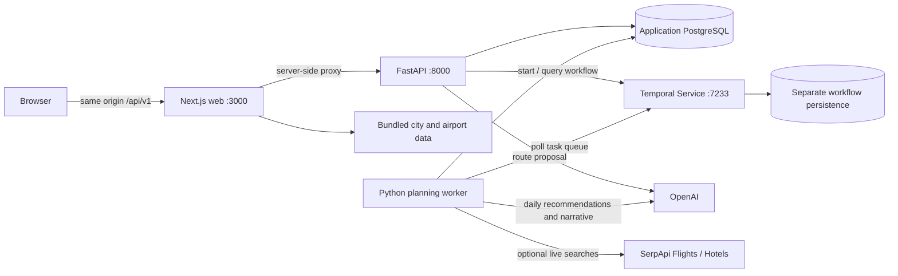

# Architecture

The web form proposes a route (`POST /api/v1/trips/route-proposal`), saves it
(`POST /api/v1/trips`), and requests planning (`POST /api/v1/trips/{id}/plan`).
The API uses a deterministic workflow ID `plan-trip-{id}` and Temporal task queue
`voyage-trip-planning`. Starting an already active workflow reuses it. A completed
itinerary is returned rather than regenerated. Failed workflows may be retried.

The worker loads the trip and marks it planning. Expanded trips use OpenAI
structured city/day recommendations, deterministic date/budget validation, optional
SerpApi selections, and optional narrative enrichment. Successful batches heartbeat
for recovery. The final itinerary and completed status are written in one database
transaction. Failure updates a safe error message. The browser polls the trip and
workflow progress before fetching itinerary JSON. Refresh recovery is not implemented.

Legacy requests without `options` retain synthetic flight/hotel/activity providers
and a version-1 renderer. This explicit path supports a no-key integration smoke
test; it does not demonstrate real travel availability. Version-2 planning requires
an OpenAI key. SerpApi offers are optional and mixed with estimates. Airbnb links
are searches only. No reservations, payment, live weather, or verified opening
hours are provided.

## Deployment choices

Application components are Deployments; web and API have internal ClusterIP
Services. Worker health is internal to its Pod and exposes no public service.
Only the web Service is routed through optional ingress, so browser requests never
need a cluster DNS name or an API URL embedded at build time. `NEXT_PUBLIC_API_URL`
remains a backwards-compatible build-time override for direct API development.

Migrations use the API image as a Job, running before installation or upgrade.
The same hook maps to Argo CD PreSync. Its database Secret must exist beforehand;
local dependencies are bootstrapped separately so a pre-install migration can reach
the DB on the first install. A PostgreSQL advisory lock serializes migration runs.
Schema changes must remain compatible with the currently running application.

Application data belongs in externally managed PostgreSQL for production.
Temporal must use a separately managed production service/persistence. Local
Kubernetes provides a single PostgreSQL StatefulSet and a separate SQLite Temporal
StatefulSet, both with PVCs. These are local learning dependencies, not HA services.
They never mount or modify Compose volumes.

One replica per application component is sufficient for the intended small private
workload. No HPA or service mesh is added. Worker concurrency is bounded separately
from replicas; retries and provider calls can still consume quota. Existing workflow
histories constrain worker changes: drain workflows or implement compatible worker
versioning before incompatible deployments.
